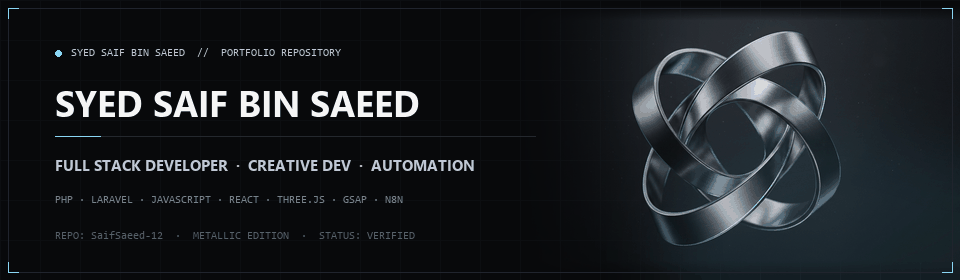
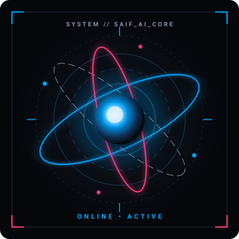
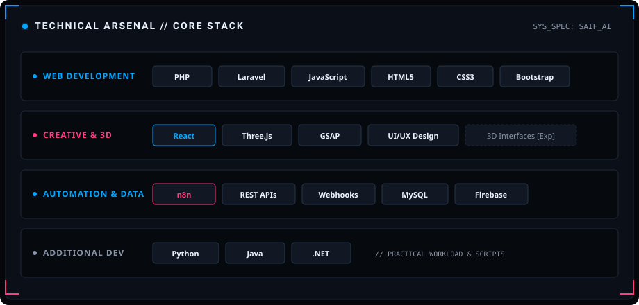
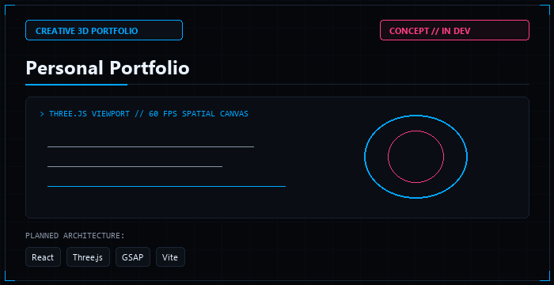
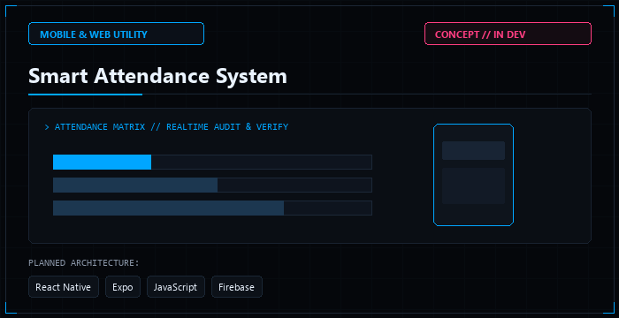
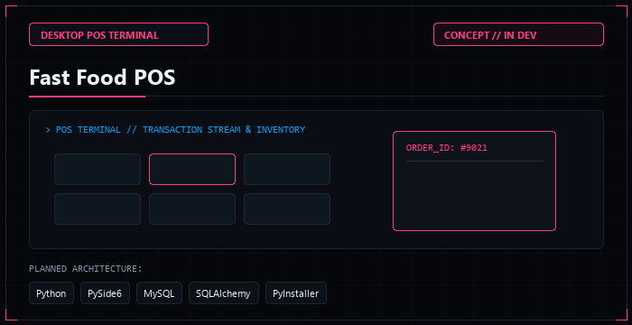
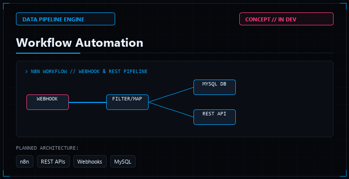

<!-- Section A — Cinematic Header: SAIF AI Animated Core Banner -->
<picture>
  <source media="(prefers-color-scheme: dark)" srcset="assets/github-motion.gif">
  <source media="(prefers-color-scheme: light)" srcset="assets/github-banner.png">
  
</picture>

 
 

# Building Intelligent Digital Experiences.

  <b>Syed Saif Bin Saeed</b> 
  Full Stack Developer &nbsp;•&nbsp; Creative Developer &nbsp;•&nbsp; Automation Enthusiast 
  <code>CODE. CREATE. AUTOMATE. EVOLVE.</code>

  
  
  

---

### Section B — AI System Panel

<table>
  <tr>
    <td width="35%" align="center" style="background-color: #05070B; border: 1px solid #1C2634; border-radius: 8px;">
      
       
      <b>SAIF AI // COMMAND INTERFACE</b>
    </td>
    <td width="65%" style="background-color: #0B1018; border: 1px solid #1C2634; border-radius: 8px; padding: 18px;">
      <b>SYSTEM:</b> <code>ONLINE</code> 
      <b>FOCUS:</b> <code>FULL STACK DEVELOPMENT</code> 
      <b>MODE:</b> <code>LEARNING &amp; BUILDING</code> 
      <b>AUTOMATION:</b> <code>EXPLORING</code> 
      

      <i>Note: Decorative profile status indicators representing active developer directives. Not a live monitoring service.</i>
    </td>
  </tr>
</table>

---

### Section C — About Me

I am a developer focused on constructing dependable software systems, modern web architectures, and engaging digital interfaces. My engineering path and technical interests center around:

- 💻 **Full-Stack Web Development:** Engineering maintainable web applications, clean REST backends, and structured database architectures.
- 🎨 **Creative Interfaces & UI/UX:** Designing intuitive user flows, clear information hierarchies, and refined interactive UI components.
- 🌐 **3D Web Experiences & Motion Design:** Exploring spatial web techniques, Three.js viewports, and smooth animation sequences with GSAP.
- ⚡ **Workflow Automation & API Integrations:** Connecting multi-service environments through automated pipelines using n8n, webhooks, and REST endpoints.
- 🛠️ **Continuous Improvement:** Building practical applications, adhering to clean code standards, and systematically documenting project architecture.

---

### Section D — Technical Arsenal

A categorized summary of languages, frameworks, and tools I use and actively explore:

  

 

<b>View Text-Based Arsenal Directory</b>

 

- **Web Development:** PHP, Laravel, JavaScript (ES6+), HTML5, CSS3, Bootstrap
- **Creative Development:** React, UI/UX Design (Figma), GSAP, Three.js *(Exploring 3D Interfaces)*
- **Automation & Data:** n8n Workflow Automation, REST APIs, Webhooks, MySQL, Firebase
- **Additional Programming:** Python, Java, .NET

---

### Section E — Featured Projects

> **Status Notice:**  
> These initiatives represent active engineering and design projects currently in progress. As codebases and repositories are formally published to GitHub, direct repository and live demo links will be activated. Preview thumbnails reflect illustrative concept mockups.

 

<table>
  <tr>
    <td width="50%" valign="top">
      
       
      <b>01 // Personal Portfolio</b> 
      <b>Stack:</b> React · Three.js · GSAP · Vite 
      <b>Status:</b> <code>IN DEVELOPMENT</code>
      

        A futuristic 3D developer portfolio showcasing interactive WebGL viewports, spatial fluid animations, and high-performance creative experiments.
      

    </td>
    <td width="50%" valign="top">
      
       
      <b>02 // Smart Attendance System</b> 
      <b>Stack:</b> React Native · Expo · JavaScript · Firebase 
      <b>Status:</b> <code>IN DEVELOPMENT</code>
      

        A cross-platform mobile and web application built to streamline attendance management across administrators, instructors, parents, and students with structured cloud sync.
      

    </td>
  </tr>
  <tr>
    <td width="50%" valign="top">
      
       
      <b>03 // Fast Food POS</b> 
      <b>Stack:</b> Python · PySide6 · MySQL · SQLAlchemy · PyInstaller 
      <b>Status:</b> <code>IN DEVELOPMENT</code>
      

        A dedicated desktop point-of-sale terminal managing dining and takeaway orders, itemized billing, local ticket printing, and real-time inventory management.
      

    </td>
    <td width="50%" valign="top">
      
       
      <b>04 // Workflow Automation</b> 
      <b>Stack:</b> n8n · REST APIs · Webhooks · MySQL 
      <b>Status:</b> <code>EXPERIMENTAL / IN PROGRESS</code>
      

        Practical workflow automation pipelines built with n8n and event-driven webhooks to handle data transformations, multi-service sync, and operational efficiency.
      

    </td>
  </tr>
</table>

---

### Section F — GitHub Activity

<!-- Verified GitHub Statistics Cards configured in Jet Black, Cerulean Blue, and Neon Rose -->

 
<i>Note: Activity statistics automatically populate from verified GitHub telemetry as public commits and repositories are published.</i>

---

### Section G — Current Focus

- 🎯 **Improving Full-Stack Development Skills:** Implementing robust architectural patterns across PHP/Laravel and modern JavaScript.
- 🚀 **Building Practical Applications:** Developing reliable, usable software tools that solve tangible business and workflow problems.
- 🌐 **Exploring 3D Interfaces & Web Animation:** Deepening proficiency in Three.js camera coordination, shader fundamentals, and GSAP timelines.
- ⚡ **Learning Workflow Automation:** Experimenting with self-hosted n8n pipelines, webhook listeners, and multi-API integrations.
- 📖 **Publishing Documented Projects:** Releasing well-structured, open-source repositories with comprehensive setup and architectural guides.

---

### Section H — Contact

Open to discussing software development, creative frontend collaborations, and automation projects:

- 🐙 **GitHub:** [@SaifSaeed-12](https://github.com/SaifSaeed-12)
- ✉️ **Email:** [saifsaeed923@gmail.com](mailto:saifsaeed923@gmail.com)

---

### Section I — Footer

  
   
  "Designed with curiosity. Built with code."
   
  © 2026 Syed Saif Bin Saeed &nbsp;•&nbsp; SAIF AI Experience

