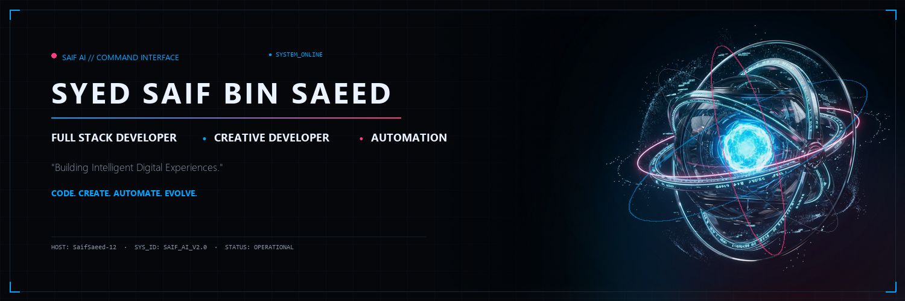

<!-- Custom Hero Banner: Minimal Metallic Edition -->
<picture>
  <source media="(prefers-color-scheme: dark)" srcset="assets/github-banner.png">
  <source media="(prefers-color-scheme: light)" srcset="assets/github-banner.png">
  
</picture>

 
 

# Building useful digital experiences.

  I'm a developer interested in full-stack web development, creative interfaces, interactive 3D experiences, and practical workflow automation.

  
  
  <!-- Update the link below once your portfolio website is deployed -->
  

---

### About Me

I am a developer focused on engineering reliable web systems and engaging digital experiences. My work centers on:

- **Building practical web applications** using modern full-stack architectures and clean patterns.
- **Designing clear and intuitive interfaces** that prioritize user experience and usability.
- **Exploring creative web technologies** like 3D WebGL (Three.js) and interactive motion design (GSAP).
- **Automating repetitive workflows** using integration engines like n8n and REST APIs.
- **Improving projects through continuous learning**, systematic code quality, and structured documentation.

---

### Technology Stack

A categorized overview of the core technologies, frameworks, and tools I work with:

#### Web Development

  
  
  
  
  
  

#### Creative Development & Interfaces

  
  
  
  

#### Automation & Data

  
  
  
  

#### Additional Technologies

  
  

---

### Featured Projects

> **Project Availability Note:**  
> The projects below reflect current active and candidate development initiatives. As individual repositories are published or prepared for open-source release, repository links will be updated accordingly.

<table>
  <thead>
    <tr>
      <th width="30%">Project</th>
      <th width="45%">Description</th>
      <th width="25%">Stack & Status</th>
    </tr>
  </thead>
  <tbody>
    <tr>
      <td>
        <b>Personal Portfolio</b> 
        Interactive Developer Portfolio
      </td>
      <td>
        A creative developer portfolio highlighting interactive 3D web elements, fluid motion, and responsive interface design.
      </td>
      <td>
        <code>React</code> <code>Three.js</code> <code>GSAP</code> 
         
        <a href="https://github.com/SaifSaeed-12/portfolio">[Repository Link]</a>
      </td>
    </tr>
    <tr>
      <td>
        <b>Smart Attendance System</b> 
        Academic & Workplace Utility
      </td>
      <td>
        Automated attendance management platform with role-based dashboards, record auditing, and structured database persistence.
      </td>
      <td>
        <code>PHP</code> <code>Laravel</code> <code>MySQL</code> 
         
        <a href="https://github.com/SaifSaeed-12/smart-attendance-system">[Repository Link]</a>
      </td>
    </tr>
    <tr>
      <td>
        <b>Fast Food POS</b> 
        Point of Sale Application
      </td>
      <td>
        Order processing and billing point-of-sale interface featuring fast item entry, receipt generation, and real-time transaction state.
      </td>
      <td>
        <code>JavaScript</code> <code>Bootstrap</code> <code>MySQL</code> 
         
        <a href="https://github.com/SaifSaeed-12/fast-food-pos">[Repository Link]</a>
      </td>
    </tr>
    <tr>
      <td>
        <b>Workflow Automation</b> 
        Integration & Pipeline Engine
      </td>
      <td>
        Automated task orchestration and webhook processing pipelines to connect disparate cloud services and eliminate repetitive operations.
      </td>
      <td>
        <code>n8n</code> <code>REST APIs</code> <code>Webhooks</code> 
         
        <a href="https://github.com/SaifSaeed-12/workflow-automation">[Repository Link]</a>
      </td>
    </tr>
  </tbody>
</table>

---

### Current Focus

- 🎯 **Improving project quality and documentation:** Structuring maintainable codebases with comprehensive READMEs and architectural clarity.
- 💻 **Building practical web applications:** Delivering reliable full-stack solutions tailored for real-world utility.
- 🌐 **Exploring 3D and interactive web design:** Deepening capabilities in WebGL, Three.js shaders, and performant animations.
- ⚡ **Learning workflow automation:** Expanding multi-step pipeline capabilities using n8n and API integrations.
- 📈 **Maintaining consistent development activity:** Committing regularly and building a strong public engineering footprint.

---

### GitHub Activity

<!-- Optional, restrained activity overview configured with the Minimal Metallic theme -->

 

<i>Note: External metrics update dynamically as public repositories and commit activity are published. If widgets fail to load due to third-party rate limits, GitHub's native contribution graph remains the primary record of activity.</i>

---

### Contact and Footer

Feel free to connect or reach out regarding web development projects, creative collaborations, or engineering discussions:

- 🐙 **GitHub:** [@SaifSaeed-12](https://github.com/SaifSaeed-12)
- ✉️ **Email:** [Contact via Email](mailto:your-email@example.com) *(Update with your active email address)*
- 🌐 **Portfolio:** *(Link will be populated upon live deployment)*

 

  "Build thoughtfully. Keep learning. Improve consistently."
   
  © 2026 Syed Saif Bin Saeed · Minimal Metallic Edition

